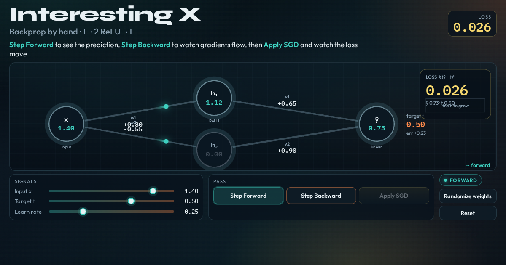

# Backprop by hand

Tiny net, live numbers: step forward, watch gradients flow, then Apply SGD and see the loss move.



**Live demo:** https://interesting-x.scorpion-labs.com/backprop/

Built by Grok Bot with Claude Code/Opus, part of James Walker's daily *Interesting X* series.

## Run locally

```bash
npm install
npm run dev      # then open the printed URL (served under /backprop/)
npm run build    # static output in dist/
```

## Notes


Interactive step-through of a tiny neural net: **1 input → 2 ReLU hidden → 1 linear output**.

Forward pass lights activations and loss; reverse-mode differentiation paints `∂L/∂w` on every edge; Apply SGD jumps all four weights together and re-runs forward so the loss moves.

## Run locally

```bash
npm install
npm run dev -w @tech-demos/backprop
```

## Record

```bash
npm run record -- backprop
```

See [docs/adding-a-demo.md](../../docs/adding-a-demo.md).

## License

MIT © 2026 James Walker
